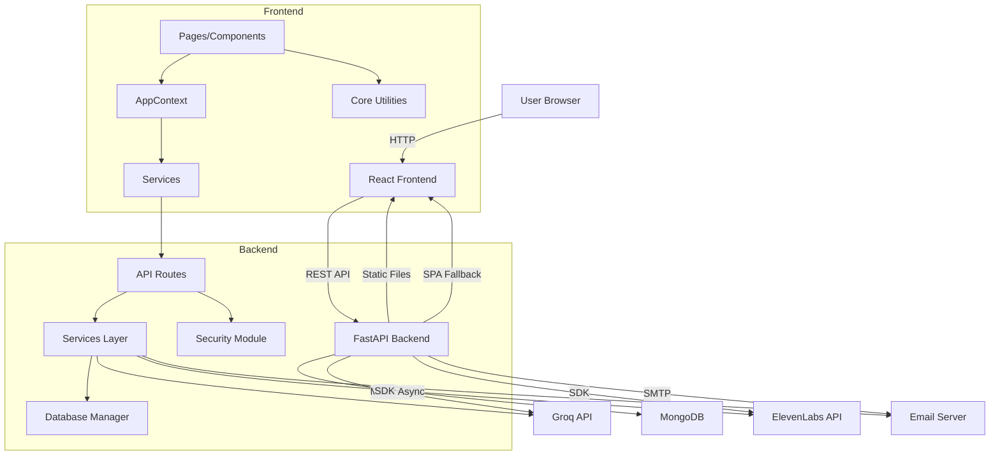
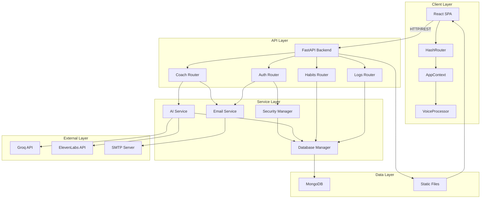

# NeuroPattern Architecture

## System Overview

NeuroPattern is a full-stack web application following a modern microservices-inspired architecture within a monolithic codebase. The system is designed as a React Single Page Application (SPA) communicating with a FastAPI backend via RESTful HTTP APIs. The architecture emphasizes asynchronous processing, type safety, and graceful degradation when external AI services are unavailable.

### Architectural Style

- **Frontend:** Client-side SPA with HashRouter for routing, React Context for state management, and lazy-loaded components for performance
- **Backend:** Async/await Python backend using FastAPI with dependency injection, Pydantic validation, and service layer separation
- **Database:** Document-oriented NoSQL database (MongoDB) with async driver (Motor) for non-blocking operations
- **Integration:** External AI services (Groq, ElevenLabs) integrated via SDKs with retry logic and graceful fallback

## Major Application Components

### Frontend (React SPA)

**Responsibilities:**
- User interface rendering and interaction
- Client-side routing and navigation
- State management for user session, logs, habits, and profile
- Audio recording and real-time quality analysis
- Language detection and text normalization
- API communication with timeout and error handling

**Directory Structure:**
```
src/
├── pages/           # Route components (lazy-loaded)
├── components/      # Reusable UI components
├── context/         # React Context providers
├── services/        # API client services
├── core/            # AI and audio processing utilities
├── utils/           # Helper functions
├── types/           # TypeScript type definitions
├── constants/       # Configuration constants
├── api/             # API configuration
├── hooks/           # Custom React hooks
└── styles/          # Global styles
```

### Backend (FastAPI)

**Responsibilities:**
- HTTP request handling and routing
- Authentication and authorization via JWT
- Business logic execution
- Database operations via Motor
- AI service integration (Groq, ElevenLabs)
- Email sending (SMTP)
- Static file serving (frontend assets, audio files)

**Directory Structure:**
```
backend/
├── app/
│   ├── main.py              # Application entry point
│   ├── database.py          # Database connection manager
│   ├── api/
│   │   ├── v1/
│   │   │   ├── api.py       # Router aggregation
│   │   │   └── endpoints/    # Route handlers
│   │   ├── core/            # Configuration and security
│   │   ├── models/          # Pydantic schemas
│   │   └── services/        # Business logic
│   └── static/              # Frontend build output and audio files
└── tests/                   # Backend tests
```

### Database (MongoDB)

**Responsibilities:**
- Persistent storage for user accounts, logs, habits, and tokens
- Indexing for efficient queries
- TTL-based token expiration
- ACID-like operations within single-document transactions

**Collections:**
- `users` - User accounts and profiles
- `logs` - Wellness check-in logs
- `habits` - Habit definitions and completion history
- `email_verifications` - Email verification tokens
- `password_resets` - Password reset tokens

### External Services

**Groq API:**
- LLM inference (Llama-3.3-70b-specdec) for emotion analysis and response generation
- Speech-to-text (Whisper-large-v3) for audio transcription
- Language detection from audio

**ElevenLabs API:**
- Text-to-speech synthesis (eleven_multilingual_v2 model)
- Multi-language voice generation

**SMTP Server:**
- Email delivery for password reset and account verification
- Configured via environment variables

## Component Interaction and Dependency Direction



**Dependency Rules:**
- Frontend depends only on Backend HTTP API
- Backend depends on Database and External Services
- External Services are independent
- Database is independent
- No circular dependencies between components

## System Architecture Diagram



## Important Runtime and Infrastructure Dependencies

### Frontend Runtime Dependencies
- Modern browser with ES6+ support
- Web Audio API (for voice recording)
- Web Speech API (fallback TTS)
- LocalStorage (for auth tokens and preferences)

### Backend Runtime Dependencies
- Python 3.11+ (audio library compatibility)
- MongoDB 7.0+ (or compatible version)
- System ffmpeg binary (for audio processing)
- Network access to Groq and ElevenLabs APIs

### Infrastructure Dependencies
- Docker (for containerized deployment)
- Node.js 20+ (for frontend build)
- pnpm or npm (package manager)

## Configuration Boundaries

### Development Configuration
- `ENVIRONMENT=development`
- Swagger UI and ReDoc enabled at `/docs` and `/redoc`
- Debug logging enabled
- CORS allows localhost origins
- Hot reload enabled for both frontend and backend

### CI Configuration
- Environment variables set via GitHub Actions
- Test-only secrets (not production keys)
- Parallel lint, test, and build jobs
- Docker image building for main branch

### Production Configuration
- `ENVIRONMENT=production`
- Swagger UI and ReDoc disabled
- Info-level logging
- CORS restricted to production domains
- No hot reload
- Gunicorn with multiple workers
- HTTPS/TLS required (not enforced by application)

## Known Architectural Limitations

1. **Monolithic Backend:** All backend logic runs in a single FastAPI application. Scaling requires horizontal scaling of the entire application rather than individual services.

2. **No Message Queue:** AI processing is synchronous within HTTP requests. Long-running AI operations could cause timeouts under load.

3. **Limited Frontend State Management:** AppContext is global and not optimized for complex state scenarios. Consider Redux or Zustand for larger applications.

4. **No Caching Layer:** No Redis or caching mechanism implemented. All data fetches hit the database directly.

5. **Static Audio Storage:** Generated audio files are stored locally and not replicated. Deployment to multiple servers would require shared storage.

6. **No Background Jobs:** Email sending and cleanup tasks are synchronous. Consider Celery or similar for background task processing.

## Proposed Architectural Improvements

### High Priority
1. **Add Caching Layer:** Implement Redis for session storage, API response caching, and rate limiting.
2. **Background Task Queue:** Use Celery or similar for email sending, audio generation, and cleanup tasks.
3. **Database Replication:** Configure MongoDB replica sets for high availability.
4. **Load Balancing:** Add nginx or similar for SSL termination and load balancing.

### Medium Priority
5. **Service Split:** Consider separating AI processing into a separate microservice for independent scaling.
6. **State Management Upgrade:** Evaluate Redux Toolkit or Zustand for more complex state scenarios.
7. **CDN Integration:** Use CDN for static assets and audio file delivery.
8. **API Gateway:** Consider Kong or similar for rate limiting, authentication, and request routing.

### Low Priority
9. **Event-Driven Architecture:** Implement event sourcing for audit logs and analytics.
10. **GraphQL:** Consider GraphQL for more flexible data fetching on the frontend.
